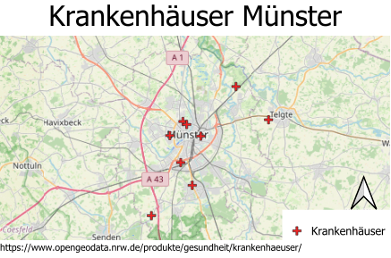
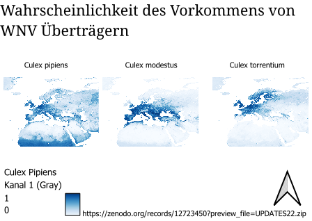
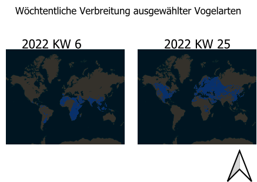
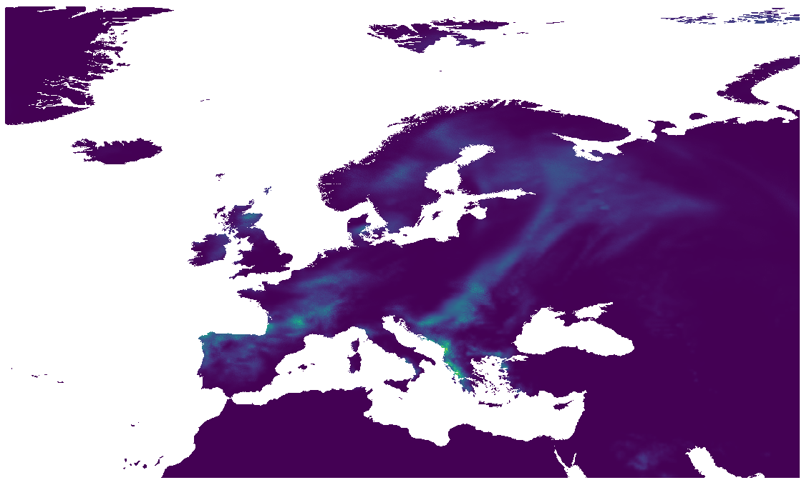

# Kategorien räumliche Daten in der Gesundheitsforschung

[@agrossm2](https://github.com/agrossm2) 

Dieses Handout befasst sich mit dem Thema räumliche Daten und wie diese im Kontext der Gesundheitsforschung angwendet werden. Es erläutert welche Arten von Datensätzen existieren und in welche inhaltliche Kategorien sie unterteilt werden

## 1. Kategorien mit Beispielen
Jede Kategorie beschreibt eine bestimmte Art von Information. Dabei können Datensätzen auch mehrere Kategorien angehören.

### 1.1 Gesundheitsbezogene Datensätze
Gesundheitsbezogene Datensätzen liefern beispielsweise Informationen zu Krankheiten, gesundheitlichen Ereignissen, Gesundheitszuständen oder Standorte medizinische Einrichtungen. 

Dabei können diese Information  in unterschiedlichen Repräsentationen auftreten:
- Punktdaten z.B Standorte von Krankenhäusern
- Zeitreihen z.B Fallzahlen pro Woche/Monat
- Statistische Daten z.B Impfquote
- Flächendaten z.b Verteilung von Impfquote auf Ebene von unterschiedlicher administrativen Einheiten

Ein [Beispieldatensatz  zu Krankenhäuser in NRW](https://www.opengeodata.nrw.de/produkte/gesundheit/krankenhaeuser/) enthält z.B räumliche Informationen zu Standorten von medizinischen Einrichtungen. Mithilfe dieser Daten kann man dann die Verteilung medizinischer Einrichtung im Land untersuchen.

### 1.2 Vektoren
Vektoren sind Organismen, welche Krankheitserreger zwischen Wirten übertragen. Durch ihre räumliche Verbreitung ist es möglich Übertragungsgebiete von Infektionskrankheiten zu untersuchen und Risikogebiete zu identifizieren.

Beispiele für Vektoren:
- Mücken
- Zecken

Vektordaten können Fundorte, Verbreitungsgebiete oder räumliche Vorkommenswahrscheinlichkeiten beschreiben.

Dieser [Beispieldatensatz](https://zenodo.org/records/12723450) beschreibt zum Beispiel die modellierte Warscheinlichkeit des Vorkommens von drei Mückenarten in Europa, welche für die Übertragung vom West-Nil-Virus (WNV) relevant sind. Die Daten liegen als Raster vor.

### 1.3 Wirte
Wirte sind Organismen, in denen Krankheitserreger leben oder sich entwickeln.Die Krankheitserreger benutzen den Wirt als Lebensraum und Nahrungsquelle.Dadurch können Wirte eine wichtige Rolle bei der Vermehrung und Verbreitung von Erregern spielen. Durch die räumliche und zeitliche Verteilung von Wirten, können mögliche Übertragungwege untersucht werden und geignete Lebensräume identifiziert werden.

Beispiele für Wirte:
- Wildvögel
- Nagetiere

Räumliche Daten zu Wirten sind beispielsweise Beobachtungorte oder Fundhäufigkeiten, sowie modellierte Verbreitungsgebiete.
In diesem [Beispieldatensatz](https://zenodo.org/records/11500313) sind Präsenz/Absenzdaten für 30 ausgewählte Vogelarten enthalten, welche als Wirt des West-Nil-Virus betrachtet werden. Dabei liegt keine Information vor, ob die beobachteten Vögel infiziert sind. Die Daten liegen im Rasterformat vor. 

### 1.4 Kovariaten
Kovariaten sind zusätzliche Einflussfaktoren, welche bei der Untersuchung der räumlichen Verbreitung von Krankheiten berücksichtigt werden. Dazu gehören Umweltdaten, Klimadaten und Bevölkerungsdaten. Sie hilfen, dabei den Zusammenhang zwischen Umweltbedingungen und den Auftreten von Krankheiten, Wirten oder Vektoren zu untersuchen.

Beispiele für Kovariaten sind:
- Temperatur z.B um zu untersuchen wie Temperaturunterschiede die Verbreitung von Vektoren beinflusst
- Niederschlag z.B Einfluss von Feutchtigkeit auf Vehalten der Vektoren
- Landnutzung z.B um mögliche Lebensräume von Wirten oder Vektoren zu identifizieren
- Bevölkerungsdichte

Kovariaten sind meistens Rasterdaten, welche mit Daten über Wirte oder Vektoren kombiniert werden um mögliche Einflussfaktoren auf die Verbreitung von Krankheiten zu identifizieren.

Dieser [Beispieldatensatz](https://doi.org/10.5281/zenodo.14987385) enthält die tägliche Niederschlagssumme in Europa für den Zeitraum von 2000-2020. Mithilfe dieses Datensatz kann man den Einfluss von Niederschlag auf das Brutverhalten von Vektoren untersuchen und so eine räumlichen Zusammenhang zwischen Umweltbedingungen und Risiko der Übertragung von Infektionskrankheiten.

### 1.5 Epidemiologische Daten
Epidemeologische Daten beschreiben das Auftreten und die Verbreitung von Krankheiten in Raum und Zeit. Unter epidemeologischen Daten fallen unter anderem Fallzahlen oder Nachweise von Krankheitseregern.

Beispiele für Epidemiologische Daten:
- aufgetrettene Fälle des West-Nil-Virus
- räumliche Verteilung von Ausbrüchen des West-Nil-Virus

Die Daten können in Form einer Tabelle, als Punktdaten oder als zusammengefasste Werte für administrative Einheiten. Kombiniert mit Wirtsdaten,Vektordaten oder Kovariatendaten kann den zeitlichen/räumlichen Verlauf des Krankheitsgeschehen untersuchen.

[Beispieldatensatz](https://vps-a4dcaa80.vps.ovh.net/)

### 1.6 Modellergebnisse
Modellergbnisse sind Resultate aus statistischen Modellen, die aus vorhanden Daten abgeleitet werden. Modellergebnisse können Vorkommenswahrscheinlichkeiten, Erstellung von Risikogebieten oder Vorhersage zur aktuellen/zukunftlichen Verbreitung von Krankheitserregern umfassen. Hierbei handelt es sich um Schätzungen und keine direkten Beobachtungen

Beispiele wären:
- modellierte Vorkommenswahrscheinlichkeiten von Vektoren (siehe Beispiel Vektoren)
-geschätzte Verteilung des Infektionsrisiko

Die Daten liegen meistens in Rasterdaten vor. Sie ermöglichen es mehrere Einflussfaktoren gleichzeitig zu berücksichtigen.

