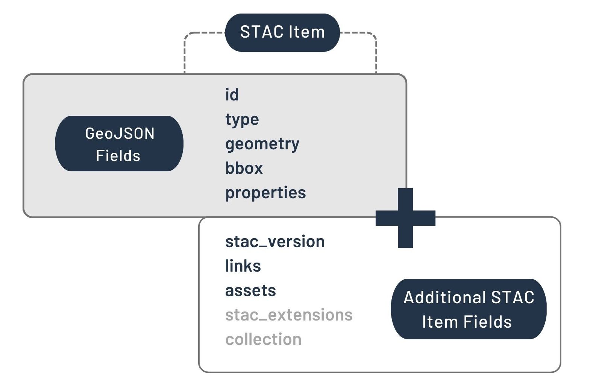
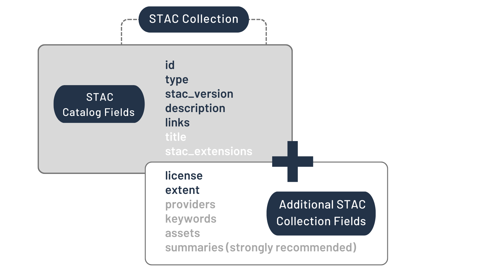
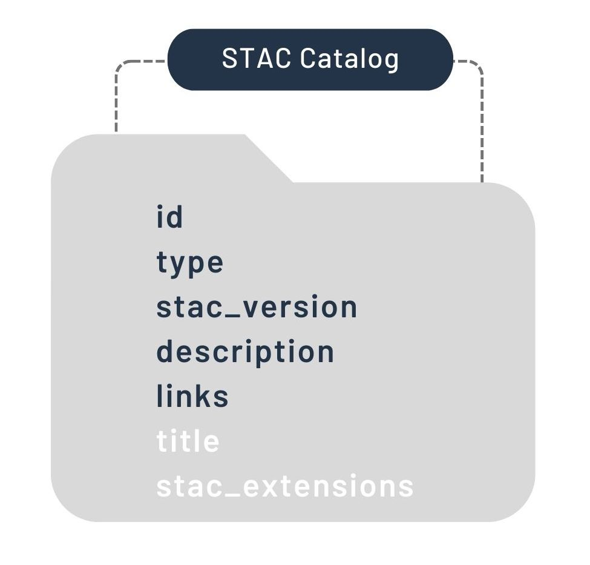

Author: [@torsten-geoloek](https://github.com/torsten-geoloek)

# STAC-Spezifikation
STAC macht Geodaten durch eine einheitliche Struktur leichter auffindbar, durchsuchbar und nutzbar.

## 1 Einführung 

### 1.1 Was ist STAC?
- SpatioTemporal Asset Catalog
- Ziel: eine einheitliche Standardsprache für die Beschreibung von Geodaten
    - Dadurch können geografische Daten einfacher gefunden, durchsucht und abgefragt werden.
- Basiert auf miteinander verknüpften JSON-Dateien.
- Ist flexibel und erweiterbar und kann an unterschiedliche Anwendungsbereiche angepasst werden.

## 2 Grundkonzept
- STAC besteht aus drei zentralen Komponenten: Item, Catalog und Collection.
- Die Komponenten werden über Links miteinander verknüpft.
- Ein Item beschreibt ein oder mehrere räumlich-zeitliche Assets und enthält zugehörige Metadaten.
- Ein Catalog dient zur Organisation und Verknüpfung von Items, Collections und weiteren Catalogs.
- Eine Collection fasst zusammengehörige Items zusammen und enthält zusätzliche Informationen über die Datensammlung.
- Die eigentlichen Daten werden als Assets referenziert; die STAC-Dateien dienen dazu, diese Daten zu beschreiben und auffindbar zu machen.

## 3 Wichtige Begriffe

### 3.1 Item
- Grundbaustein von STAC.
- Beschreibt ein oder mehrere Assets mithilfe von GeoJSON und zusätzlichen Metadaten.
- Enthält beispielsweise Informationen zur geografischen Lage und zum Zeitpunkt der Datenerfassung.

### 3.2 Collection
- Fasst zusammengehörige STAC Items zu einer Sammlung zusammen.
- Enthält zusätzliche Metadaten, beispielsweise zur räumlichen und zeitlichen Ausdehnung, zur Lizenz und zu den Datenanbietern.

### 3.3 Catalog
- Organisiert und verknüpft STAC Items, Collections und weitere Kataloge.
- Dient als Einstiegspunkt zur Navigation durch die Daten.

### 3.4 Asset
- Eine Datei, die räumlich-zeitliche Informationen über die Erde enthält, z. B. ein Satellitenbild oder eine LiDAR-Punktwolke.
- Ein STAC Item verweist auf die zugehörigen Assets.

### 3.5 Link
- Verknüpft STAC-Komponenten miteinander.
- Ermöglicht die Navigation zwischen Items, Catalogs und Collections sowie den Verweis auf zugehörige Daten.

### 3.6 GeoJSON
- Format zur Beschreibung geografischer Objekte und ihrer räumlichen Eigenschaften.
- Ein STAC Item basiert auf einem GeoJSON-Feature.

### 3.7 Metadaten
- Informationen, die einen Datensatz näher beschreiben.
- Beispiele sind Aufnahmezeitpunkt, räumliche Ausdehnung, Lizenz und Datenanbieter.

## 4 Erweiterungen
- STAC ist flexibel und kann um zusätzliche Felder und Funktionen erweitert werden.
- Extensions ermöglichen die Anpassung an bestimmte Datentypen und Anwendungsbereiche.
- Die STAC-Community entwickelt gemeinsam Erweiterungen und zusätzliche Metadatenstandards.

## 5 Quellen
- https://stacspec.org/en/tutorials/intro-to-stac/
- https://github.com/radiantearth/stac-spec/